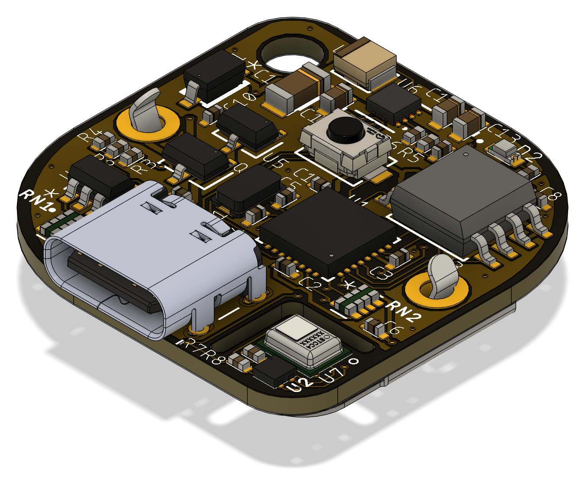

# C-Logger — 温湿度・CO2 データロガー

温度・湿度・CO2 濃度を一定間隔で記録する、26mm 角の小さなデータロガーです。
ボタン電池（CR2032）1個で動き、記録したデータは USB でパソコンに取り出して CSV で保存できます。

## 使う

| 目的 | 場所 |
|---|---|
| **ブラウザで操作する**（記録の開始、データの保存など。インストール不要） | https://et0614.github.io/c-logger/app/ |
| **取扱説明書** | https://et0614.github.io/c-logger/manual.html |
| 製品の紹介 | https://et0614.github.io/c-logger/ |

操作ページは、パソコンの Chrome または Edge で開いてください。本体を USB でつなぎ、「接続」を押して一覧から C-Logger を選びます。

## 種類

| 種類 | 記録する項目 |
|---|---|
| CO2あり版 | CO2 濃度・温度・湿度 |
| CO2なし版 | 温度・湿度 |

## 作る・改造する

回路と基板の設計、ファームウェアの仕組み、ビルドと配布の手順は **[技術解説（TECHNICAL.md）](TECHNICAL.md)** にまとめています。

| フォルダ | 内容 |
|---|---|
| `hardware/` | 回路図、基板の設計データ、製造用データ、ケース |
| `firmware/` | 本体のファームウェアと USB ブートローダ |
| `software/` | Windows 用の PC ツール（Python） |
| `docs/` | 取扱説明書と、上記のウェブページ |
