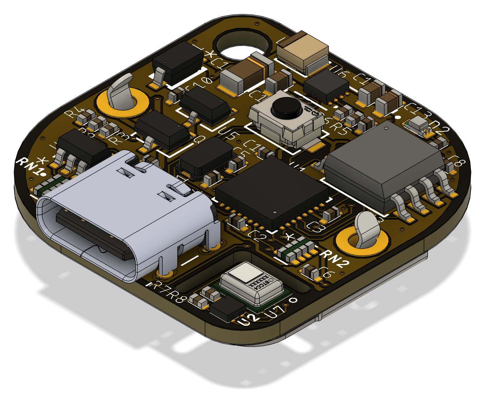

# C-Logger 取扱説明書

C-Logger は、温度・湿度（CO2あり版は CO2 濃度も）を一定間隔で記録するデータロガーです。
ボタン電池（CR2032）1個で動き、記録したデータは USB で PC に読み出して CSV ファイルにします。



## 1. 製品の種類

| 種類 | 記録する項目 |
|---|---|
| CO2あり版 | CO2 濃度・温度・湿度 |
| CO2なし版 | 温度・湿度 |

どちらの版かは、PCツールの接続時に表示される「Sensors」の欄で確認できます。

## 2. 各部の名前

- **USB 端子（Type-C）**: PC との通信と給電に使います。
- **ボタン**: ケース上面の小さな穴の奥にあります。ペン先など細いもので押してください。押している間 LED が点灯します（動作の確認用）。5秒間押し続けると記録を止めます。
- **LED（赤）**: 状態を表示します（「4. LED の表示」を参照）。
- **電池ホルダ（裏面）**: CR2032 を1個入れます。

## 3. 電池の入れ方

1. 本体を裏返し、電池ホルダの金具の下に CR2032 を横から差し込みます。
2. **＋面（文字が書かれた面）を金具側（外側）**に向けます。逆に入れると動きません。
3. 電池を入れると、USB につないでいなければ待機状態になります（LED は消灯）。

- 電池を交換するときは、記録を止めてから交換してください。記録中に電池を抜いても、それまでに記録したデータは消えません。
- USB につないでいる間は USB から給電され、電池は使いません。

## 4. LED の表示

| 状態 | LED |
|---|---|
| USB 通信中（USB につないでいる） | 1秒ごとに短く1回点滅 |
| 記録中 | 消灯（ボタンを押している間だけ点灯） |
| 待機中（電池のみ、記録していない） | 消灯（ボタンを押している間だけ点灯） |
| 電池切れ | 3秒ごとに1回点滅（記録は止まっています） |
| ファームウェア更新の待機中 | 約0.7秒ごとに短く2回点滅（「7-4. ファームウェアの更新」を参照） |

## 5. 使い方の流れ

1. **PCツールを用意する**（「6. PCツール」を参照）。
2. **記録を始める**: USB で PC につなぎ、PCツールで記録間隔を指定して記録を開始します。時刻は PC に合わせられ、それまでのデータは消去されます。
3. **設置する**: 記録を始めると本体は USB から切り離されます。USB ケーブルを抜いて設置してください。電池で記録を続けます。
4. **回収してデータを読み出す**: USB で PC につなぐと記録が止まり、USB 通信の状態になります（データは消えません）。PCツールで CSV に保存します。

記録を止める方法は2つです。

- USB で PC につなぐ
- ボタンをペン先などで5秒間押し続ける（LED が点灯したまま5秒たつと記録が止まります）

## 6. PCツール

ドライバは不要です（Windows 10 以降は、標準の USB シリアルとして認識されます）。

### 6-1. GUI 版

`CLogger.exe` をダブルクリックして起動します。署名の無い exe のため、初回に Windows SmartScreen が表示されたら「詳細情報」→「実行」を選んでください。
Python がある場合は、`pip install pyserial` の後に `python clogger_gui.py` でも起動できます。画面の表示は英語です。

1. USB でつないで **Connect** を押します（ポートは自動で見つけます）。上部に機器の情報（ファームウェアの版、機体 ID、電池電圧、保存件数、記録期間、センサの構成）が表示されます。
2. **Logging** タブ: 記録間隔（1〜3600秒）を入れて **Start logging…** を押します。メモリが何日分もつかも表示されます。
3. **Data** タブ: **Save as CSV…** で保存します。**Erase all data…** で全データを消去します。
4. **Live view** タブ: 温度・湿度（CO2あり版は CO2 も）を1秒ごとに表示します（保存はしません）。
5. **Clock** タブ: 時計のずれを測って補正します（「7-1. 時計の補正」を参照）。
6. **Calibration** タブ: 温度・湿度・CO2 の補正係数の設定と、CO2 センサの校正を行います（「7-2」「7-3」を参照）。
7. **Diagnostics** タブ: 自己診断（メモリ・センサ・計測）を行います。
8. **Firmware** タブ: ファームウェアを更新します（「7-4. ファームウェアの更新」を参照）。

### 6-2. コマンド版

`pip install pyserial` の後、USB でつないで実行します。

```
python clogger.py info              機器の情報・状態・電池電圧
python clogger.py start -i 60       時刻を合わせて記録開始（記録間隔60秒。既存データは消去）
python clogger.py read              保存データを CSV に保存
python clogger.py measure           温度・湿度（CO2）を連続表示（保存しない）
python clogger.py selftest          自己診断
python clogger.py clear             保存データの消去
python clogger.py clock -m 60       時計のずれを60分測る（--apply で補正値を書き込む）
python clogger.py clock --set 0     時計の補正値を設定する（0 で補正なし）
python clogger.py correction        温度・湿度・CO2 の補正係数を表示する
python clogger.py correction --temp 1.0 -0.3   温度の補正係数 a b を設定する（--hum、--co2 も同様。--reset で補正なし）
python clogger.py frc 420           CO2 センサを 420 ppm に校正する
python clogger.py update fw.hex     ファームウェアを更新する
```

## 7. 記録について

- **記録間隔**: 1〜3600秒。
- **記録できる件数**: 約275万件（記録間隔1分で約5年、1秒で約1か月）。いっぱいになると記録を止めます（古いデータを上書きしません）。
- **時刻**: 各記録の時刻は、記録間隔の終わりの時刻です。
- **CO2（CO2あり版）**: 記録開始直後の約24秒はセンサの準備を行うため、記録はその後から始まります。CO2 は各記録間隔の最後の5秒間の平均、温度・湿度はその最後の測定値です。記録開始から約1時間はセンサの暖機中で、CO2 の値は精度が出ていないことがあります（この間、本体は記録間隔によらず毎秒計測を続けてセンサを安定させます）。
- **電池切れ**: 電池の電圧が 2.0V を下回った状態が10秒続くと、データを守るため記録を止めます。

### CSV の形式

| 列 | 内容 |
|---|---|
| index | 記録の番号（0から） |
| epoch | 時刻（UNIX時刻、秒） |
| datetime | 時刻（PC の時刻帯で表示） |
| temp_C | 温度 [℃]（補正後） |
| hum_pct | 相対湿度 [%]（補正後） |
| co2_ppm | CO2 濃度 [ppm]（補正後。CO2なし版は空欄） |
| temp_raw_C | 温度 [℃]（補正前） |
| hum_raw_pct | 相対湿度 [%]（補正前） |
| co2_raw_ppm | CO2 濃度 [ppm]（補正前。CO2なし版は空欄） |

補正は「7-2. 測定値の補正」の補正係数によるもので、補正係数が設定されていなければ補正後と補正前は同じ値です。
計測に失敗した記録は、温度・湿度・CO2 がすべて空欄になります。

### 7-1. 時計の補正

本体の時計は水晶で動いており、1台ごとに最大で ±20 ppm（1日に ±1.7 秒、1か月に ±52 秒）程度ずれることがあります。
記録の時刻をより正確にしたいときは、PC の時計を基準にずれを測り、補正値を本体に保存できます。補正値は電池を抜いても消えません。

1. PC の時刻をインターネットの時刻に合わせます（Windows の「設定」→「時刻と言語」→「今すぐ同期する」）。
2. 本体を USB でつなぎ、10分ほど置いて温度を落ち着かせます。測定中は室温を大きく変えないでください。
3. GUI 版の **Clock** タブで測定時間（60分を推奨）を選び、**Measure** を押します。測定中は PC と本体をつないだままにしてください。
4. 終わると、ずれ（Drift）と推奨の補正値（Suggested）が表示されます。**Apply correction** で本体に保存します。
5. 確認したいときは、もう一度測ります。ずれが 0 に近ければ補正できています。

- 補正は 1 ppm 単位、±127 ppm まで設定できます。**Reset correction to 0** で補正をやめられます。
- 水晶は温度によっても少しずれます（25℃ から 10℃ 離れると、遅れる向きに約 3 ppm）。

### 7-2. 測定値の補正

基準の温湿度計や CO2 計と比べてずれがあるときは、1台ごとに補正係数を設定できます。

　補正後の値 = a × 補正前の値 + b

1. 基準の計器と並べて、同じ環境で比べます（GUI 版の **Live view** タブで本体の値を見られます）。
   - ずれが一定なら、a = 1 のまま、b にずれを打ち消す値を入れます（例: 本体が基準より 0.3℃ 高ければ b = −0.3）。
   - 2つの条件（例: 低温と高温）で比べたときは、2点を通る直線から a と b を求めます。
2. GUI 版の **Calibration** タブで温度・湿度・CO2 の a と b を入れ、**Save to device** を押します。**Reset (no correction)** で補正をやめられます。

- 補正係数は本体に保存されます（電池を抜いても、ファームウェアを更新しても消えません）。どの PC から読み出しても同じ補正がかかります。
- 本体のメモリには補正前の値を記録し、PCツールが表示や CSV 保存のときに補正します。そのため、補正係数を後から直すと、記録済みのデータにも新しい補正係数が使われます。CSV には補正前の値も出力されます。
- 設定できる範囲: a は 0.8〜1.2、b は温度 ±5℃、湿度 ±15%、CO2 ±2000 ppm。温度・湿度でこれを超えるずれがあるときは、センサの劣化や故障が考えられるので、本体の交換をおすすめします。
- 温度を電源の発熱の影響なしで比べたいときは、USB を外して電池で記録し、後から読み出して比べてください（USB 接続中は基板が少し温まります）。

### 7-3. CO2 センサの校正（CO2あり版）

CO2 センサ自体を、濃度の分かっている空気に合わせて校正します（強制校正、FRC）。校正の結果はセンサの中に保存されます。
センサは使いながら自動で校正する機能も持っていますが、その機能は週に一度以上は外気（約 420 ppm）に触れることを前提にしています。そうでない使い方や、長く保管した後に合わせ直したいときに使います。

1. 本体を、CO2 濃度が分かっていて安定している場所に置きます。外気を基準にするなら、風の弱い屋外か、窓を大きく開けて十分に換気した室内に置き、人が近づかないようにします（人の息で CO2 が上がります）。
2. GUI 版の **Calibration** タブで基準の CO2 濃度（外気なら 420 ppm）を入れ、**Recalibrate…** を押します。
3. 約1分間（40回）計測した後、校正します。終わると、センサが行った補正量が表示されます。

- 基準の濃度が本当に正しいときだけ行ってください。誤った濃度で校正すると、以後の値がすべてずれます。
- 7-2 の補正係数とは別のものです。FRC の後は、CO2 の補正係数を a = 1、b = 0 に戻しておくのがおすすめです。

### 7-4. ファームウェアの更新

新しいファームウェア（`.hex` ファイル）が公開されたときは、USB で書き換えられます。記録したデータ、時計の補正値、測定値の補正係数は消えません。

1. 電池を外し、USB ケーブルも抜きます。
2. ボタンをペン先などで押したまま、USB ケーブルで PC につなぎます。
3. LED が約0.7秒ごとに短く2回点滅する（ファームウェア更新の待機状態）ようになったら、ボタンを離します。
4. GUI 版の **Firmware** タブで **Browse…** からファームウェアのファイルを選び、**Update** を押します。
5. 「Firmware updated」と表示されたら、USB ケーブルを抜き差しします。新しいファームウェアで起動します。

## 8. 困ったとき

| 症状 | 確認すること |
|---|---|
| PC につないでも認識されない | USB ケーブルが充電専用でないか。別のケーブルや USB ポートで試す |
| PCツールで見つからない | 他のソフトが同じ COM ポートを開いていないか |
| 接続に時間がかかる | まれに、接続できるまで30秒ほどかかることがあります。USB を抜かずにそのままお待ちください |
| 電池で動かない（ボタンを押しても LED が点かない） | 電池の向き（＋面が外側）、電池の残量 |
| LED が3秒ごとに1回点滅する | 電池切れです。新しい電池に交換するか、USB につないでデータを読み出してください |
| 温度が高めに出る | USB につないだ直後は基板が温まっています。電池で動かしてしばらく置いてください |

## 9. 仕様

| 項目 | 内容 |
|---|---|
| 電源 | CR2032 ×1、USB 給電（USB 接続中は電池を使わない） |
| センサ | 温湿度: Sensirion SHT40、CO2（CO2あり版）: Sensirion STCC4 |
| 記録容量 | 16MB（約275万件） |
| 通信 | USB 2.0 Full Speed（仮想 COM ポート）、Type-C |
| 外形 | 基板 26 × 26 mm |

センサの精度は、各センサのデータシート（`hardware/datasheet/`）を参照してください。

## 10. ソフトウェアのライセンス

PCツールの GUI 版（`CLogger.exe`）には、ファームウェアの書き込みのために avrdude 8.1（GPL v2）を同梱しています。ライセンス文は `COPYING_avrdude.txt` です。同梱している avrdude のソースコードは、この配布から3年間、求めに応じて提供します。[GitHub の Issues](https://github.com/et0614/c-logger/issues) からご連絡ください。
